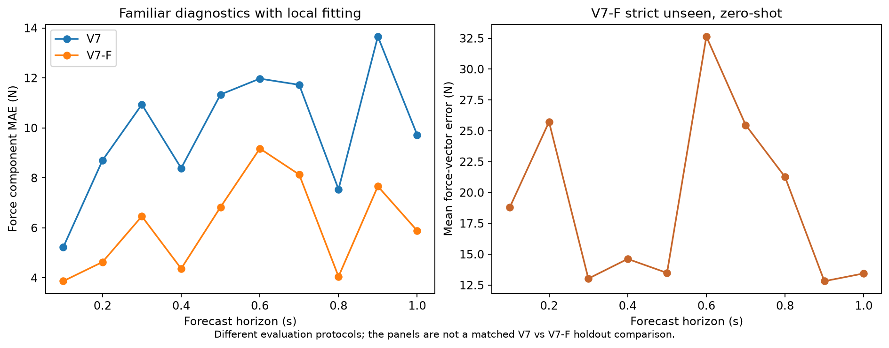

# Krishna Karthikeya G N

Robotics world models and language-model research. This portfolio documents research code, measured results, and coursework completed during 2026. It is organized by project and evaluation protocol so a reader can tell a finished measurement from an early experiment or a proposed extension.

## Selected work

| Project | What is here | Evidence status |
|---|---|---|
| [V7 and V7-F robot dynamics](ugp/v7-v7f/README.md) | Research notebook, aggregate force results, plotted comparison | Saved RTX training and evaluation artifacts; familiar and strict-unseen tests are separate |
| [V8 contact-map experiments](ugp/v8-contact-map/README.md) | Standalone notebook and aggregate A–D/F exports | Offline modules with limited diagnostics; E/F remained shadow/replay |
| [FeelWM and TartanGround](ugp/feelwm-tartanground/README.md) | Five-stream world-model source, data interface, four pilot result files | Executed capped pilots; final ten-epoch strict comparison unavailable |
| [V7 SHORT foothold memory](ugp/foothold-memory/README.md) | Research notebook and four-environment summary | Trained model and restricted scored-window evaluation; incomplete event and leg coverage |
| [3D Terrain–Foothold World Model](ugp/terrain-foothold-world-model/README.md) | Architecture and pilot/validation record | Separate project; no independent test or completed 20-epoch run established |
| [CS781 course projects and assignments](cs781/README.md) | Architecture, experiment, and assignment record | Course solution code and official materials held back pending public-sharing review |

The two panels use **different protocols**. The left compares V7 and V7-F on familiar diagnostic cases with local fitting. The right reports only V7-F on four excluded trajectories without held-out updates; it is not evidence of a matched holdout improvement over V7.

## How to read this repository

- Start with each project README for the architecture, dependencies, run status, and limits.
- [Evidence and provenance](EVIDENCE.md) identifies the source snapshots, transformations, and claims that still need validation.
- [Publication notes](PUBLICATION.md) explain what was deliberately excluded from the public copy.
- Original datasets, checkpoints, hidden-test predictions, credentials, institutional paths, and private server details are not distributed.

**Attribution:** Presented by Krishna Karthikeya G N. These projects include research and course work performed with software assistance and, where applicable, shared project inputs. Individual third-party models and data retain their original owners and terms. This repository does not claim sole authorship of shared code or a license for third-party material. No blanket license is granted pending a source-by-source rights review.
