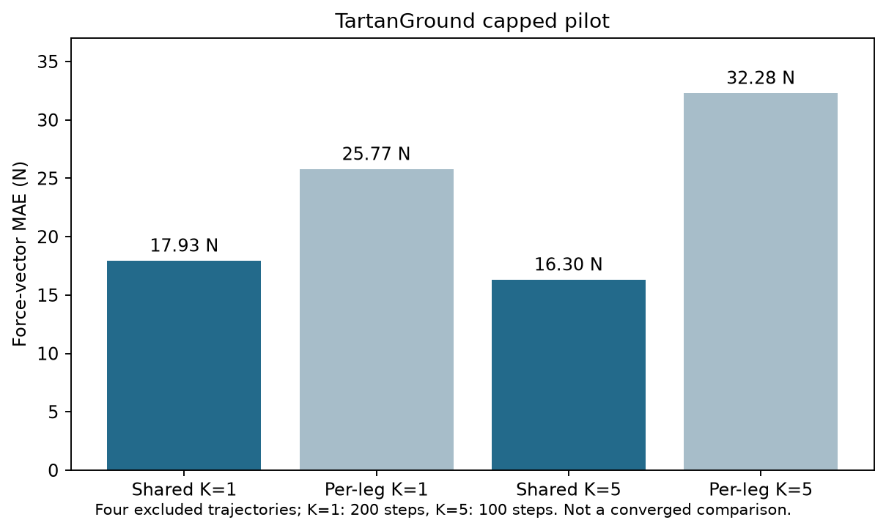

# FeelWM and TartanGround comparison

The `src/` directory preserves the local merged FeelWM/V7/V7-F source snapshot, including the model, dataset interface, trainer, validation code, and a synthetic smoke test. It predicts future visual latents autoregressively while the original V7 branch predicts requested robot horizons directly. The project expects four 16×256 visual branch blocks per frame, assembled into a 64×256 packet. See the source `config.py` and `data.py` for the tensor contract.

## Measured pilot

Four excluded trajectories produced 5,037 evaluation anchors. Capped training was 200 optimizer steps for K=1 and 100 for K=5. Force-vector MAE (N): shared K=1 **17.93**, per-leg K=1 **25.77**; shared K=5 **16.30**, per-leg K=5 **32.28**. The four original `strict_test_metrics.json` files are under `results/`. This is an early pilot, not a converged comparison.

The historical ten-epoch continuation had three saved epoch-10 components and one paused component when audited on 5 October 2026. A final matched 40-case strict export was absent then, and the server could not be reached for a fresh check on 23 October 2026.

## Running the source

Use Python 3.10+ with `pip install -r src/requirements.txt`. From `src/`, run `python smoke_test.py` for a synthetic shape/backward check. Real training requires a JSONL manifest of preprocessed tensor shards and pretrained visual features as documented in the source. The distributed snapshot excludes local launch configurations, raw recordings, and weights. The smoke test does not verify published research scores.
