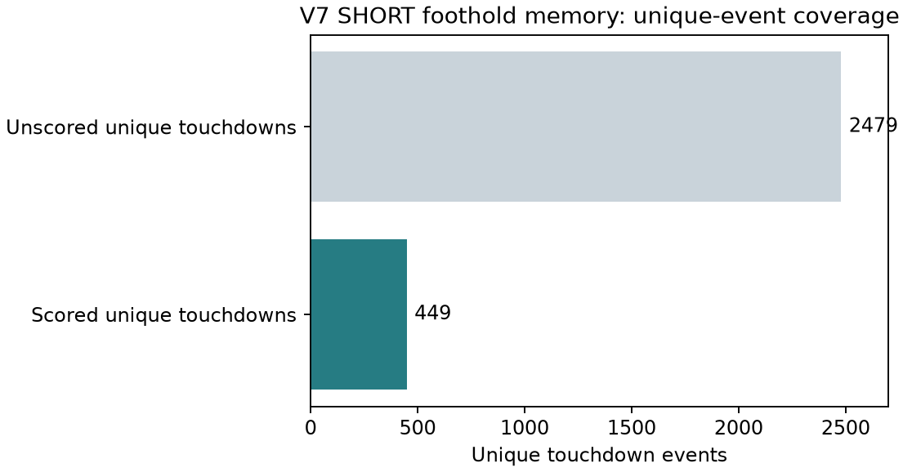

# V7 SHORT spatial-temporal foothold memory

This extension predicts a local foothold cell, position, and timing from causal visual history and robot state. The notebook is a sanitized code snapshot; the private recordings, calibration file, trained weights, and raw row-level event data are not published.

The saved three-epoch evaluation used four excluded trajectories. It scored 1,007 windows: 483 with touchdown and 524 without. Across unique events, 449 of 2,928 touchdowns were scored in at least one valid window (**15.3% coverage**). Touchdown-only cell accuracy was 416/483 (**86.13%**); position MAE was **0.179 m** and timing MAE **0.0196 s** on scored rows. The RL and RR legs had zero scored touchdown rows. These conditional scores do not establish all-leg or all-event performance, and no matching original-V7 target baseline is available.

Reproduction requires the same private synchronized robot/RGB-D data, timestamp alignment, camera calibration, PyTorch, and the V7 feature stack. The public notebook has no execution outputs and has not been rerun as published.
