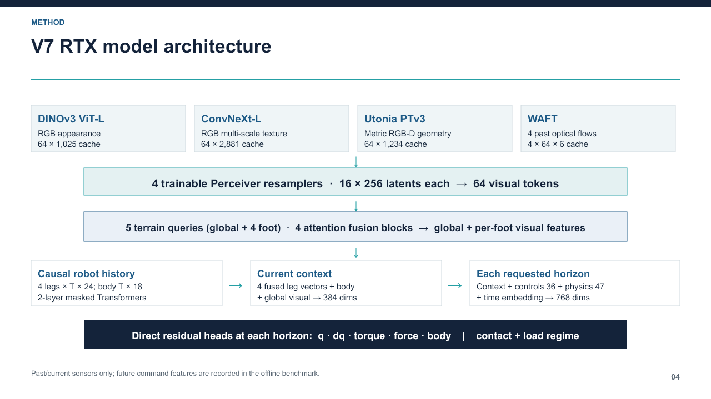

# V7 and V7-F: multimodal robot dynamics

V7 combines frozen visual feature branches (DINOv3, ConvNeXt, geometry and flow), causal robot history, terrain queries, and direct fixed-horizon prediction. V7-F freezes the V7 trunk and adds a horizon-aware force specialist. This is offline prediction work, not a deployed robot controller. Recorded future controller commands appear in the benchmark feature path and would need planned commands online.

## Artifacts

- `notebooks/v7_v7f_research_snapshot.ipynb` is a **publication-sanitized source snapshot**. Execution outputs and local/server identifiers were removed. The historical notebook contains later V8 cells; their status is described in `EVIDENCE.md` rather than treated as one completed model.
- `results/familiar_v7_vs_v7f.csv` contains familiar diagnostic force component MAE by horizon. At +0.1 s: V7 5.22 N, V7-F 3.87 N; at +1.0 s: 9.72 N and 5.89 N. These cases used local per-test fitting.
- `results/strict_unseen_v7f.csv` contains zero-shot V7-F force-vector error on four excluded trajectories, four anchors each, 64 leg-vectors per horizon: 18.79 N at +0.1 s and 13.44 N at +1.0 s. No matched strict-holdout V7 export is included.

## Reproduction boundary

Python, PyTorch/CUDA, NumPy, and separately obtained pretrained visual backbones are needed. The notebook expects private robot recordings, calibration, and precomputed visual caches that are not distributed. Set local data and model paths before execution; the publication copy is for architecture inspection and does not establish that a fresh run will reproduce the saved scores.
